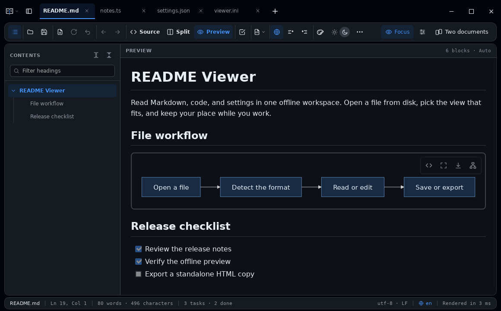
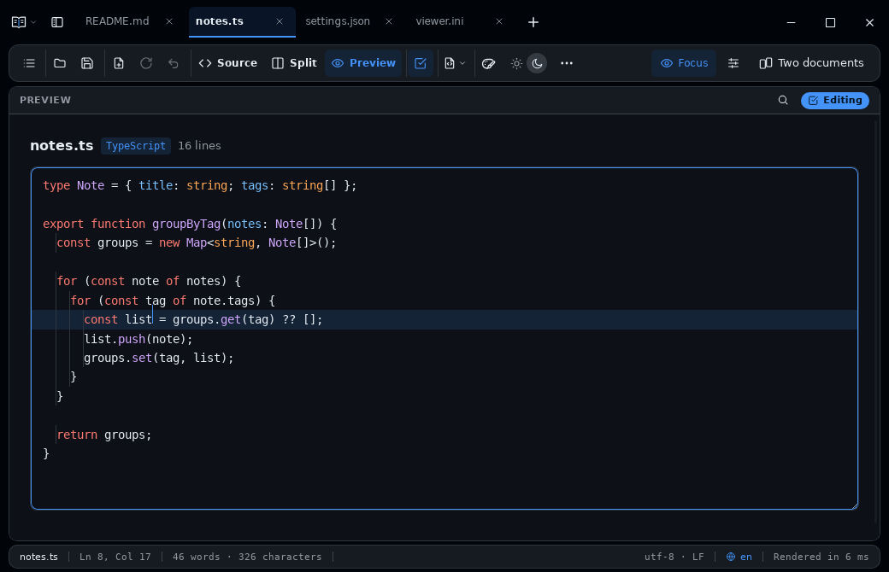
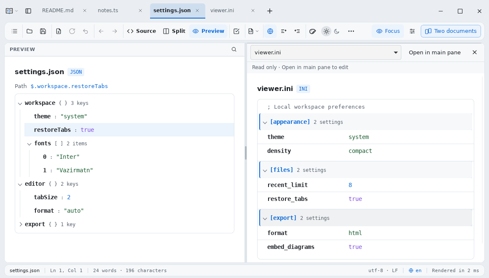

# README Viewer

**An offline workspace for Markdown, source code, and configuration files.**

Read project READMEs with their diagrams and task lists. Open a source file to fold a function and edit a line in place. Navigate JSON trees and grouped INI settings.

**[Download the latest release][release]** · [What’s new in 2.1.0][notes] · [Try without installing](#try-without-installing)

*Markdown preview in the desktop app, with an offline Mermaid diagram and open tabs for code and configuration.*

## Download

These are the **2.1.0** packages. The [release page][release] includes SHA-256 checksums and signed desktop updates.

| Platform | Download | Requirements |
| --- | --- | --- |
| Windows | [x64 installer][windows] | Windows 10 or 11 with WebView2 |
| Linux | [x64 Debian package][deb] or [x64 AppImage][appimage] | Compatible Linux with WebKitGTK 4.1 |
| Android Preview | [ARM64 APK][arm64] or [x86_64 APK][x86_64] | Android 8.0 or later with an updated System WebView |

Desktop users can upgrade through **Help → Check for updates**. For installation details, AppImage integration, and Android signing and save behavior, see the [native app guide](docs/native-app.md).

## Read and edit source code

The app bundles **186 syntax grammars** for offline use. Search across syntax tokens, follow indentation guides, and fold blocks in supported languages. Turn on **Edit in preview** to type directly in the code pane with undo and redo. Small, unwrapped files can keep their syntax colors while you edit.

## Navigate JSON and INI

Expand JSON objects and arrays, select a key to see its path, or read INI settings grouped by section. Turn on **Edit in preview** to change a configuration value. The app can recognize JSON and INI-style settings in files such as `.conf` and `.cfg`. Override detection with **Preview format** in the toolbar or with `Ctrl+Shift+L`.

## Preview SVG and HTML

Open SVG files as images, zoom in for details, or browse reusable SVG symbols in a gallery. Preview HTML offline with local stylesheets, images, and fonts from the document’s folder on desktop. **Preview / Code** switches between the rendered file and its source.

## Read Markdown and Mermaid

Jump between headings in Contents, tick a task in the rendered page, and view Mermaid diagrams offline. Export the document as standalone HTML or save a diagram as SVG. The demo includes flowcharts, sequence diagrams, and math labels. [View the sample document](docs/demo.md)

Keep related files in tabs, compare two documents side by side, or use **Focus** to give one document the full window. On desktop, the last workspace reopens by default with saved files and local drafts. Manage this in **File → File settings → Restore open documents**. **View → Appearance** has light and dark themes, font choices, and adjustable title-bar opacity on supported desktops.

The interface is available in English and Persian. Mixed-direction Markdown renders each block according to its text, so Persian and English can appear in the same document.

## Get started

1. Use **Open** or drag in a file. On Windows and Linux, you can also choose **README Viewer** from the system’s **Open with** menu for supported file types.
2. Choose **Source**, **Split**, or **Preview**. To make changes from the rendered view, turn on **Edit in preview**.
3. Press `Ctrl+S` to save. A new tab suggests a filename that matches its format, such as `Untitled.cpp`. On Android, the first save of an opened file creates a copy.

| Shortcut | Action |
| --- | --- |
| `Ctrl+O` / `Ctrl+S` | Open / Save |
| `Ctrl+1` / `Ctrl+2` / `Ctrl+3` | Source / Split / Preview |
| `Ctrl+E` | Toggle Edit in preview |
| `Ctrl+Shift+L` | Choose a preview format |
| `Ctrl+Shift+F` / `Ctrl+F` | Find in the document / Filter Contents |
| `F8` / `Esc` | Enter / Leave Focus |

## Try without installing

Download the [2.1.0 source ZIP][source], extract the whole archive, and open `index.html` in a browser. Keep the extracted folders together so the preview, syntax grammars, and diagrams work offline. Choose **Load sample document** on the empty screen to try it out.

Chrome and Edge can save back to a file you’ve opened when the browser grants file access. Other browsers download the saved copy. Remote images and external links can still use the network.

## Project documentation

[Native setup and builds](docs/native-app.md) · [Updates and signing](docs/updates.md) · [Size budgets and UI validation](docs/size-and-ui-audit.md) · [Changelog](CHANGELOG.md) · [Report an issue][issues]

Run the JavaScript tests with `npm ci && npm test`. For browser and platform checks, see [validation in the native app guide](docs/native-app.md#validation-status).

[release]: https://github.com/k1nosraty/readme-viewer/releases/latest
[notes]: https://github.com/k1nosraty/readme-viewer/releases/tag/v2.1.0
[windows]: https://github.com/k1nosraty/readme-viewer/releases/download/v2.1.0/README.Viewer_2.1.0_x64-setup.exe
[deb]: https://github.com/k1nosraty/readme-viewer/releases/download/v2.1.0/README.Viewer_2.1.0_amd64.deb
[appimage]: https://github.com/k1nosraty/readme-viewer/releases/download/v2.1.0/README.Viewer_2.1.0_amd64.AppImage
[arm64]: https://github.com/k1nosraty/readme-viewer/releases/download/v2.1.0/README-Viewer-2.1.0-Android-ARM64-Debug-Preview.apk
[x86_64]: https://github.com/k1nosraty/readme-viewer/releases/download/v2.1.0/README-Viewer-2.1.0-Android-X86_64-Debug-Preview.apk
[source]: https://github.com/k1nosraty/readme-viewer/archive/refs/tags/v2.1.0.zip
[issues]: https://github.com/k1nosraty/readme-viewer/issues
