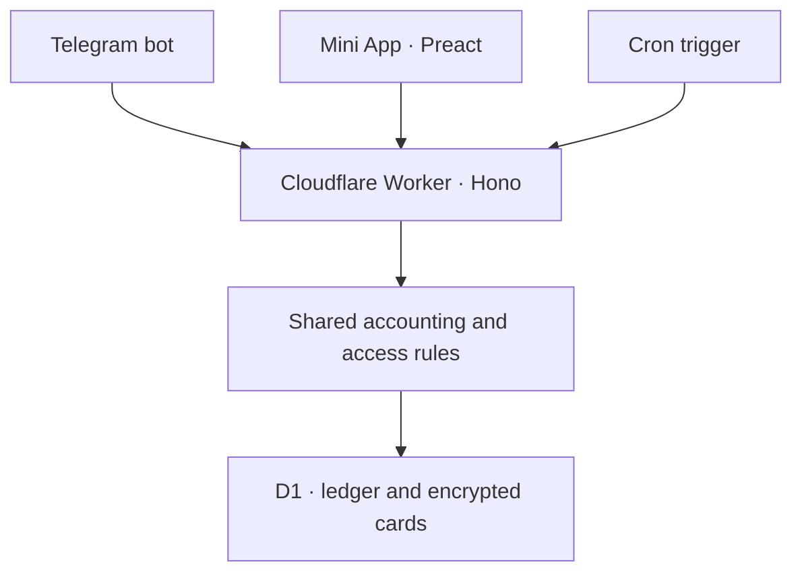

# README Viewer

A local, offline Markdown and README viewer with a live preview, a table of contents, synchronized
scrolling, and **interactive task lists**: with *Edit in preview* turned on, you can tick a checkbox
in the rendered document and the Markdown source is updated — one `[ ]` → `[x]` at a time, with
every other byte of the file left exactly as it was.

Version 1.5.1 adds signed desktop updates, stronger opt-in draft recovery, distraction-free reading
and an About dialog. It improves rendering speed, save safety and compact-screen usability while
preserving full offline Mermaid, mathematical labels and selectable fonts on Windows, Linux and
Android Preview.
Open and Save use native file dialogs and direct file access in the app window. The portable
browser application remains supported and needs no build step. Remote document images and
external links can still use the network.

## Native application (1.5.1)

Native 1.5.1 includes independent document tabs, a resizable second reading pane, link context menus,
bookmarks, section folding, a collapsible outline and optional session restoration. File / Edit /
View / Help menus complement a customizable toolbar. View > Appearance offers accent presets,
custom colors, warm/cool surfaces, interface density and live reading preferences.
The release workflow runs all platform checks before publishing the installers and APK in
[GitHub Releases](https://github.com/k1nosraty/readme-viewer/releases/tag/v1.5.1).
Earlier downloads remain available.

| Platform | Native package and requirements |
| --- | --- |
| Windows | NSIS `.exe` installer, per user; Windows 10/11 and current Microsoft Edge WebView2. No Windows Authenticode signature is provided; in-app updates use a separate cryptographic signature. If WebView2 is missing, its bootstrap installer needs internet on first installation. |
| Linux | `.deb` for Ubuntu/Debian with WebKitGTK 4.1, or `.AppImage` for compatible Linux systems. Both open an application window. |
| Android | Tauri Preview debug APK for ARM64/x86_64; Android 8.0+ and an updated Android System WebView. Development-signed, distributed outside Play Store. |

Install from the 1.5.1 release: run the per-user installer on Windows; install the .deb with your
software manager or make the .AppImage executable and open it on Linux; on Android, install the
APK matching your device and allow your downloader to install apps when prompted. Every installer
and APK has a SHA-256 checksum beside it.

The 1.5.1 builds keep the full offline Mermaid bundle, optimize the native Release binary and
distribute Android Preview APKs separately for ARM64 and X86_64. CI measures actual installer
sizes against [explicit budgets](docs/size-and-ui-audit.md); frontend size is reported separately.

Help → Check for updates offers download/install and optional in-app version notices. Help → About
includes the installed version and [developer GitHub](https://github.com/k1nosraty). Older versions
need one manual upgrade to gain update checks. Android 1.4.0 used a temporary signing identity;
upgrading to the stable 1.5.1 Preview identity may require reinstalling. Save documents outside the
app first; uninstalling can remove local drafts.

No Node.js or Python is needed to use native packages. Click **Open**, choose your Markdown,
turn on **Edit in preview** to change task checkboxes, then click **Save**. Desktop Save writes
back to the opened file. Android's first Save asks where to write a copy; the source stays
unchanged, and later saves update your chosen copy. Desktop packages
register Markdown file associations; choose README Viewer in your system's **Open with** menu
if needed. You can also drop a file onto the desktop app.

See [native setup, builds and limitations](docs/native-app.md). The Java Android Preview in
[android/README.md](android/README.md) belongs to the historical 1.0.2 release.

## Portable browser application

Download the portable ZIP, **extract the whole archive**, and keep `index.html`, `src/` and
`vendor/` together. Double-click `index.html` or `Launch-README-Viewer.bat` on Windows.
Historical Linux portable archives use `./Launch-README-Viewer.sh` and require a browser and
`xdg-open` (or `sensible-browser`). Historical installers launch the browser application.

```bash
open index.html          # macOS
xdg-open index.html      # Linux
start index.html         # Windows
```

Or serve the folder and open http://localhost:8080:

```bash
python3 -m http.server 8080 --bind 0.0.0.0
```

Chrome and Edge support saving back to the original file where the File System Access API is
available. Other browsers download an updated copy; replace the original with it if needed.

## Features

Mermaid diagrams, fonts and the updated sample document are included in the v1.5.1 installers.

- **GitHub-accurate rendering** — headings, tables, task lists, fenced code with syntax
  highlighting, block quotes, images, strikethrough, footnotes-free GFM, hover heading anchors.
- **Three view modes** — Source, Split, Preview (`Ctrl+1/2/3`), with a draggable divider that is
  remembered between sessions.
- **Interactive task lists** — optional, explicit, and safe (see below).
- **Table of contents** — live outline with a filter (`Ctrl+F`) and click-to-jump in both panes.
- **Synchronized scrolling** — proportional, both directions, per block.
- **Direction aware** — every rendered block gets its own `dir`, so a Persian paragraph inside an
  English README is laid out right-to-left while the interface stays LTR. Manual LTR/RTL override
  included.
- **Themes** — Light, Dark and System, applied to the chrome, the rendered Markdown and the
  syntax highlighting.
- **Real file access** — native Open/Save on desktop and Android; in the browser, save back to the same file where the File System Access API exists
  (Chromium), download elsewhere; reload from disk; drag a file *or a whole folder* onto the window
  (a dropped folder is searched for a README and used as the base for relative links).
- **Encoding care** — UTF-8 with or without BOM, UTF-16 LE/BE with or without BOM, legacy
  `windows-1256`/`windows-1252` fallback, CRLF preserved on save, binary files rejected with a
  clear message.
- **Updates and About** — Help includes release checks, optional automatic update notices,
  signed desktop download/install, and developer information. Android opens the matching APK
  for OS-confirmed installation. See [release setup](docs/updates.md).
- **Unsaved-changes protection** — a dirty document is never replaced silently, and closing the tab
  warns.
- **Opt-in recovery for large drafts** — File → Session → Restore open documents keeps transactional
  recovery copies on this device, including unsaved edits. Failed updates preserve the previous
  copy; recovered documents ask where to save.
- **Distraction-free reading** — View → Distraction-free reading, or `F8`, hides the application
  chrome and centers the document. Press `Esc` or the visible exit button to restore your workspace.
- **Save conflict protection** — external file changes offer Overwrite, Save as or Cancel; desktop
  native saves stage and flush a sibling file before replacing the destination.
- **Incremental preview updates** — unchanged blocks retain their DOM, expanded details and diagrams;
  bounded caches avoid repeating sanitization and syntax highlighting for identical output.
- **Offline Mermaid diagrams** — flowcharts, sequence diagrams, mindmaps and architecture diagrams,
  with source/copy controls, an expandable zoom view, SVG downloads and embedded HTML exports.
- **Standalone HTML export** — the rendered document as one self-contained file.
- **English interface**, with a complete Persian locale one setting away (`Help → Interface
  language`). Documents in any language render as-is.

## Mermaid diagrams

Select **Load sample document** on the empty screen, or open [docs/demo.md](docs/demo.md)
in README Viewer. Both include a system flowchart, a Persian sequence diagram, an entity
relationship diagram, a pie chart, a mindmap, an architecture diagram and mathematical labels, alongside ordinary Markdown examples.

Wrap diagram source in a fenced block labelled `mermaid`, just as on GitHub:

````markdown

````

Diagrams render locally in Preview, Split and the second reading pane. The pinned Mermaid
full bundle (including the ELK layout engine) loads only when the document contains a diagram, never from a CDN. Use **Source**
to inspect the original code, the existing **Copy** action to copy it, **Expand** to zoom and
scroll, or **Save SVG** to save a standalone image using the platform's normal save dialog.
Diagram actions are compact icons in the upper-right corner: they brighten on hover or keyboard
focus, remain visible on touch screens, and have accessible labels/tooltips. Source opens below
the diagram; no extra action bar occupies document space. HTML exports embed diagram images
and remain readable offline without JavaScript.

The original Markdown is never changed by rendering. Invalid or unsupported diagrams retain
their source with an explanation. Light/dark themes and Persian labels are supported, with the
existing system font stack by default. Optional font choices are available in **View → Appearance → Fonts**.

Use the **Layout** selector under a flowchart to compare Dagre and ELK. Layout choices are
kept for up to 24 diagram sources during the current session. Full Mermaid 11.17.2 is pinned
for compatibility with older WebViews. Embedded Mermaid configuration, external images,
interactive diagram links and arbitrary HTML remain disabled. Labels containing `$$...$$`
render powers, fractions, integrals and matrices using the already bundled KaTeX engine and
native MathML inside sanitised SVG images. HTML wrappers are enabled only for mathematical
diagrams and restricted to text/MathML; ordinary diagrams keep SVG text labels. A browser or
system WebView with native MathML support is required. Unsupported environments and invalid
formulas retain the source with an explanation. Diagrams are limited to 50,000 source characters and 500 edges. This is not a promise
of exact rendering parity with whichever Mermaid version GitHub currently uses.

### Font choices

In **View → Appearance → Fonts**, choose a Latin/other-script family and a separate Persian/Arabic
family. Interface text has its own optional family. Suggestions include Arial, Segoe UI, Georgia,
Tahoma, Noto Sans Arabic, Noto Naskh Arabic and Amiri. Preset menus always show all choices.
Choose **Other installed font…** to enter another family name for other languages. The app checks only the names you choose; it does not enumerate system fonts
or request font permissions. Missing families fall back safely. Clear a field for the original
font stack. Code remains monospace.

Vazirmatn 33.003 is included under SIL OFL 1.1 (about 111 KB of font data, loaded only when selected).
All other fonts use the user's own installation; their files are not copied or redistributed.
Font changes preview live and persist only on **Apply**; **Cancel**, Escape and restoring defaults
keep the same reversible behavior as the rest of Appearance. Standalone HTML and SVG exports
embed the included font when selected. System fonts remain local and may look different on
another device. See [font licensing](vendor/fonts/README.md).

See [the pinned bundle and license](vendor/mermaid/README.md) for update details.

## Interactive preview

README Viewer is a viewer first. Interactive editing is opt-in, limited to elements where direct
manipulation makes sense, and it never turns the preview into a WYSIWYG editor.

1. Turn on **Edit in preview** (toolbar, or `Ctrl+E`). The button lights up and the preview pane
   shows an *Editing* badge.
2. Hovering a task checkbox highlights it; clicking toggles it.
3. The Markdown source changes immediately, the document is marked as modified, and focus stays on
   the checkbox you clicked.

### The source is the source of truth

There is no shadow copy of your checklist. Each rendered checkbox carries a `data-rv-task` index
that is matched, on every render, against a map built from the parser's token tree:

```
Markdown source ──lex──▶ tokens ──walk──▶ [{ index, line, start, end, checked, label }]
                                     │
                                     └── index i  ⇄  i-th rendered <input data-rv-task="i">
```

`src/tasks.js` walks the token tree in document order, tracks the source line of every node from
the verbatim `raw` text of the nodes before it, then locates the marker on that line with an
anchored regex and records its character offsets. Toggling replaces those three characters and
nothing else — so two identically-worded tasks never cross-talk:

```markdown
- [ ] Install Qt        ← clicking this one
- [ ] Install Qt        ← leaves this one alone
```

Before a click is accepted, the code re-checks that `source.slice(start, end)` still is a marker;
if the document moved underneath the map, it refreshes and asks you to click again rather than
editing blind. If the token tree and the source ever disagree, interactive editing switches itself
off for that document and says why, instead of risking a wrong edit.

The edit is applied with `textarea.setRangeText()`, preserving the source selection. Browser-native
undo behavior for programmatic edits varies; save important edits before closing the app.

## Architecture

The application shell is `app.js`; everything that can be reasoned about without a DOM lives in
`src/` as dependency-free modules (plain scripts with a UMD footer, so the same files run in the
browser from `file://` and in Node under test).

| File | Responsibility |
| --- | --- |
| `index.html` | markup, icon placeholders, `data-i18n` hooks |
| `styles.css` | design tokens, layout, chrome, Markdown overrides |
| `app.js` | DOM wiring, application state, settings, file I/O, render pipeline |
| `src/tasks.js` | task checkbox ↔ source offset map, and the three-character toggle |
| `src/markdown.js` | marked configuration, renderer overrides, DOMPurify policy |
| `src/encoding.js` | bytes → text (BOM, UTF-16, legacy code pages, line endings) and back |
| `src/direction.js` | per-block and per-document direction, content language detection |
| `src/highlight.js` | syntax highlighting, result cache, lazy language loading |
| `src/export.js` | standalone HTML export |
| `src/updates.js` | release notices, signed update flow and About |
| `src/drafts.js` | transactional local recovery storage, without a bundled database library |
| `src/i18n.js` | interface strings (`en` default, `fa` included) |
| `src/icons.js` | the SVG icon set |
| `vendor/` | marked, DOMPurify, highlight.js, github-markdown-css — committed on purpose |

Concerns stay separated on purpose: rendering never touches files, file I/O never touches the DOM
tree of the preview, and the interactive bridge (`bindTasks` / `toggleTaskFromPreview` in `app.js`)
is the only place where the two meet.

## Tests

```bash
npm ci          # installs the locked test dependencies (including jsdom)
npm test
```

The JavaScript suite covers:

- `tests/tasks.test.js` — the interactive task-list contract: ordering, duplicates, nesting,
  Persian text, block quotes, ordered lists, code blocks, byte-level preservation, stale maps.
- `tests/markdown.test.js` — renderer output, GitHub classes, anchors, sanitiser policy.
- `tests/encoding.test.js` — BOM/UTF-16/legacy encodings, CRLF round-trip, binary rejection.
- `tests/direction.test.js` — RTL/LTR detection per block and per document.
- `tests/highlight.test.js` — alias resolution, the highlight cache, unknown languages.
- `tests/app.test.js` — the real `index.html` + `app.js` in jsdom: click a checkbox, watch the
  source change, the dirty dot appear, focus return; plus XSS, unsaved-changes, localisation,
  every toolbar control and keyboard shortcut, and a 250-section stress document. These skip
  themselves (with a loud warning) if jsdom is not installed.

## Keyboard

| Shortcut | Action |
| --- | --- |
| `Ctrl/⌘ + O` | Open a file |
| `Ctrl/⌘ + S` | Save |
| `Ctrl/⌘ + Shift + S` | Save as |
| `Ctrl/⌘ + 1 / 2 / 3` | Source / Split / Preview |
| `Ctrl/⌘ + E` | Toggle *Edit in preview* |
| `F8` | Toggle distraction-free reading (`Esc` exits) |
| `Ctrl/⌘ + F` | Filter the table of contents |
| `Tab` / `Shift + Tab` | Indent / outdent (never during IME composition) |
| `Esc` | Close a dialog, or leave the editor |

## Browser support

Current Chrome, Edge, Firefox and Safari. Saving in place and reloading from disk use the File
System Access API (Chromium); everywhere else the app falls back to downloads. Lazy-loaded
highlighter languages need the app to be reachable over `http(s)` or `file://` (they are plain
`<script>` tags from `vendor/langs/`).

## Vendored dependencies

`marked` (MIT), `DOMPurify` (MPL-2.0/Apache-2.0), `highlight.js` (BSD-3),
`github-markdown-css` (MIT). They are committed in `vendor/` so the app works offline; nothing is
fetched by the application at runtime. Remote document images and links follow normal browser
network behavior. Saving converts decoded text to UTF-8 and preserves UTF-8 BOM and LF/CRLF style.

## Builds and validation

See [native build instructions](docs/native-app.md) for Tauri packages and preview checks.
`python3 scripts/package-release.py` builds the portable browser ZIP and checksum. The historical
release workflow packages the browser launchers and Java Android Preview; native preview builds
use `.github/workflows/native.yml`. Existing releases are never overwritten.
