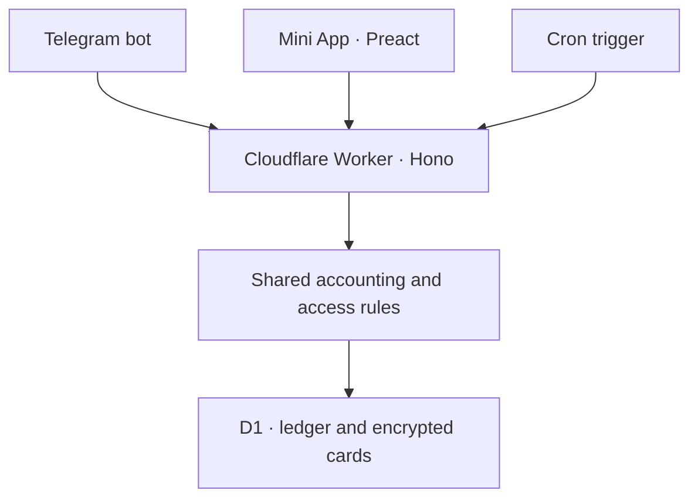
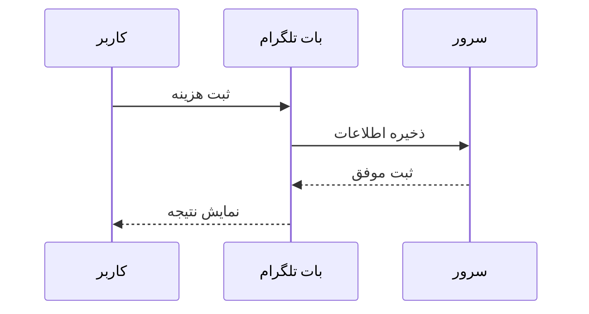
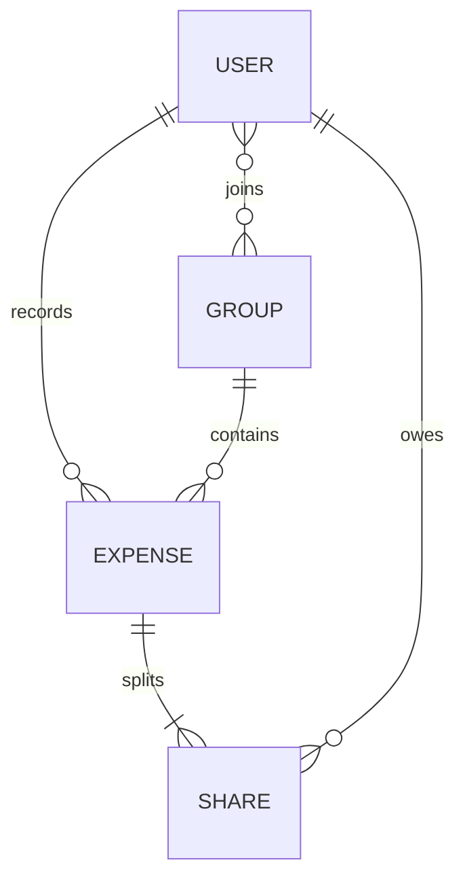
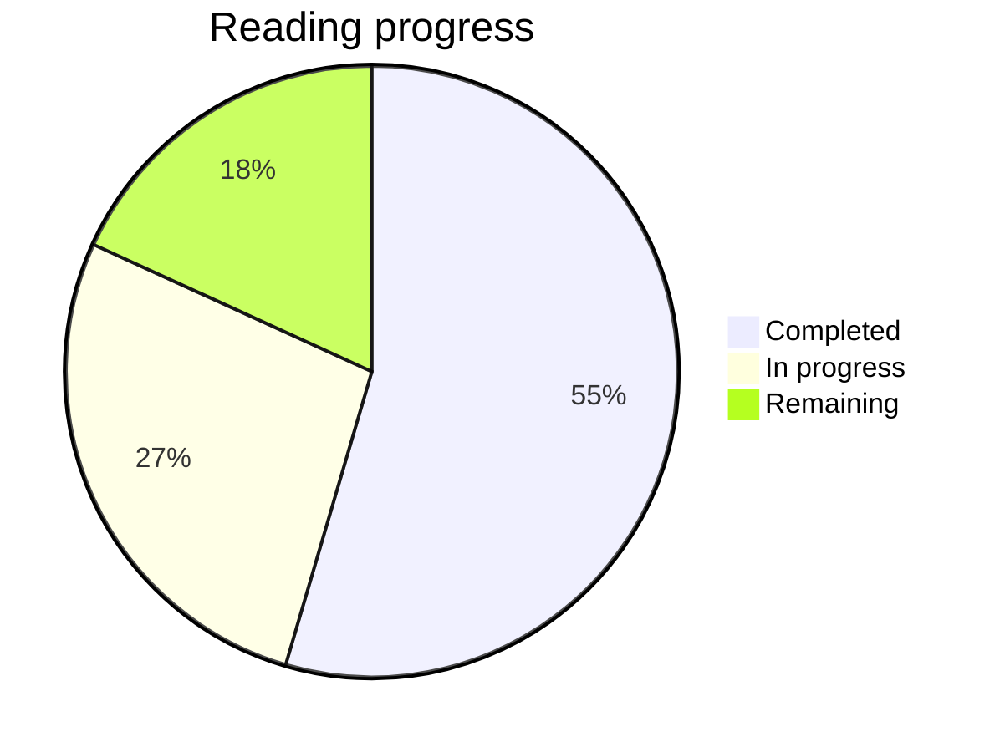
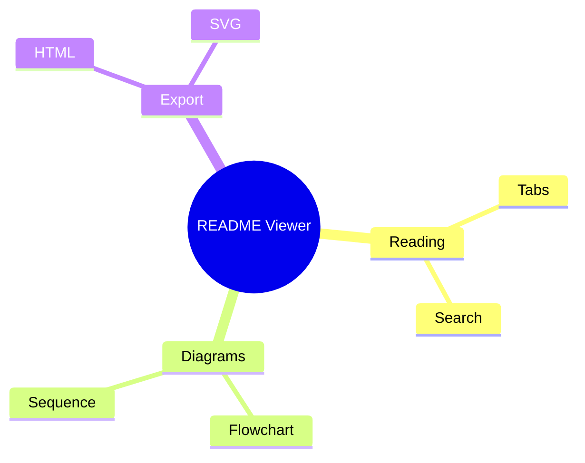
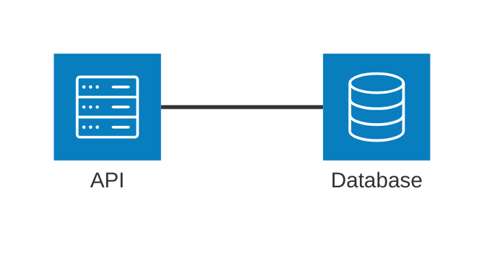
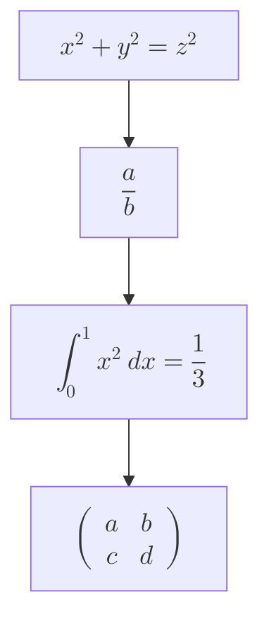

# README Viewer

A local, offline Markdown reader. This sample doubles as a rendering test:
headings, tables, code, links, **bold**, *italic*, ~~strikethrough~~ and `inline code`.

## Diagrams

These diagrams render offline in Preview, Split and the second reading pane.
Use **Source** to show the code, **Expand** to zoom, or **Save SVG** to save an image.

### System flowchart



### نمودار توالی فارسی

این نمونه برای بررسی شکل حروف فارسی و پیام‌های رفت‌وبرگشت است.



### Entity relationships



### Progress overview



> [!NOTE]
> These diagrams render offline with full Mermaid. Use the Layout control on a flowchart to compare Dagre with ELK.


### Mindmap



### Architecture




### Mathematics

Formula labels use native MathML generated by the bundled Mermaid engine.
Try Expand, Save SVG and Export as HTML; no network or extra math fonts are needed.




## Tasks

Turn on **Edit in preview**, then click any checkbox — only its `[ ]` marker is rewritten.

- [x] Render GitHub flavoured Markdown
- [ ] Learn PostgreSQL
- [ ] Ship the release notes
  - [x] Draft the changelog
  - [ ] Tag the next release
- [ ] Duplicate task
- [ ] Duplicate task

> Block quotes keep their own direction, and nested lists stay aligned.

## Code

```python
def greet(name: str) -> str:
    return f"Hello, {name}!"
```

```bash
npm test && open index.html
```

## Table

| Feature | Status | Notes |
| --- | :---: | --- |
| Task lists | ✅ | Interactive in preview |
| RTL content | ✅ | Per block |
| Offline | ✅ | No network calls |

## فارسی

این پاراگراف راست‌به‌چپ است و جهت آن به‌صورت خودکار تشخیص داده می‌شود.
متن فارسی در میان متن English باید درست نمایش داده شود، بدون به‌هم‌ریختن پرانتزها (parentheses).

- [x] پشتیبانی از کیبورد فارسی
- [ ] پشتیبانی از ورودی چینی و ژاپنی (IME)

---

Links: [external](https://github.com) and a relative [reference][ref].

[ref]: https://example.com "Reference"
